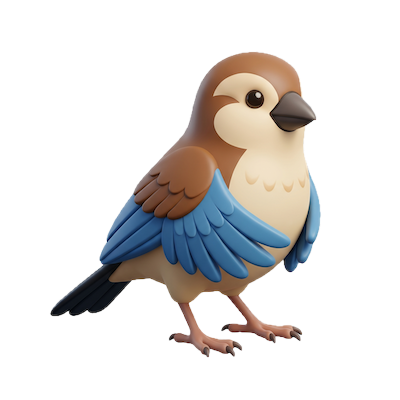
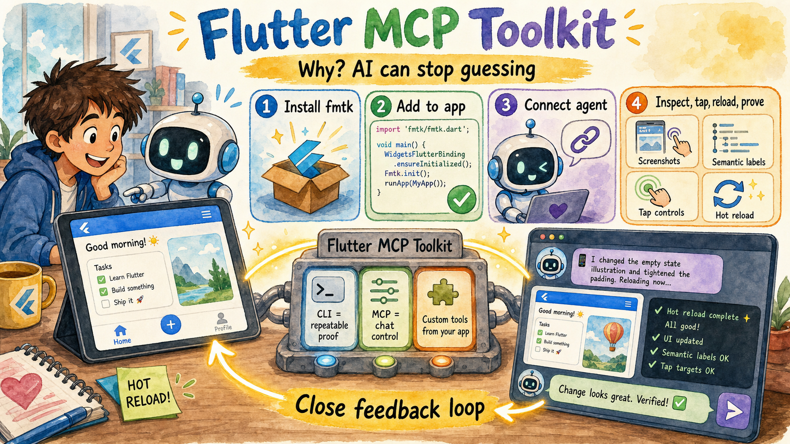

<div align="center">



# flutter-mcp-toolkit

[](https://mcptoplist.com/server/glama%2FArenukvern%2Fmcp_flutter)

_Inspect and drive a running Flutter app from your AI assistant._

[](https://skills.sh/arenukvern/mcp_flutter)
[](https://pub.dev/packages/mcp_toolkit)
[](https://github.com/Arenukvern/mcp_flutter/actions/workflows/contract_gates.yml)
[](https://github.com/Arenukvern/mcp_flutter/actions/workflows/intentcall_eval.yml)
[](https://github.com/Arenukvern/mcp_flutter/actions/workflows/skill_assets_drift.yml)
[](https://docs.page/arenukvern/mcp_flutter/)
[](https://deepwiki.com/Arenukvern/mcp_flutter)
[](https://opensource.org/licenses/MIT)
[](https://flutter.dev)
[](https://smithery.ai/server/@Arenukvern/mcp_flutter)
[](https://registry.modelcontextprotocol.io/v0/servers/io.github.Arenukvern%2Fflutter-mcp-toolkit/versions)
[](https://github.com/Arenukvern/mcp_flutter#contributors-)
<a title="Discord" href="https://discord.com/invite/y54DpJwmAn" ></a>
[](https://github.com/Arenukvern/skill_steward)

</div>

Docs: [docs.page/arenukvern/mcp_flutter](https://docs.page/arenukvern/mcp_flutter/) · [llms.txt](./llms.txt) · Contribute: [guide](docs/contributing/guide.mdx)

**flutter-mcp-toolkit** is a Dart MCP server plus the `mcp_toolkit` Flutter package. An agent can discover your debug app, read semantic UI snapshots, tap and type, hot-reload, and call **custom tools your app registers at runtime** — a closed loop with runtime proof instead of guessing.



The picture's story: the toolkit gives an AI assistant a shared window and control loop into a running Flutter app, so it can inspect state, act like a user, hot reload, read proof, and use custom tools from your app instead of guessing.


## See it in action

Existing walkthroughs (YouTube):

- Dynamic tools in Cursor — [short video](https://www.youtube.com/watch?v=Qog3x2VcO98)
- Grok Build (2026, June) — [video](https://youtu.be/P0ObCyt0k3M)
- IntentCall / WebMCP projection — [video](https://www.youtube.com/watch?v=mX4xxVeImq0)
- Cursor MCP setup — [video](https://www.youtube.com/watch?v=pyDHaI81uts)

Full list and suggested watch order: [Video walkthroughs](docs/concepts/video-walkthroughs.mdx).

## Evaluate in 30 seconds

| Question | Answer |
| --- | --- |
| What is it? | MCP server (`flutter-mcp-toolkit-server`) + in-app `mcp_toolkit` bootstrap over the VM service. |
| What can an agent do? | Inspect UI/errors, drive widgets, reload, screenshots (Flutter render pipeline), dynamic app tools. |
| When to use this vs [Dart MCP](https://github.com/dart-lang/ai/tree/main/pkgs/dart_mcp_server)? | **Dart MCP:** Dart/Flutter *tooling* (analyzer, tests). **This toolkit:** a *running debug app* (UI + your app-defined tools). |
| When not to use it? | Release builds, no debug VM, or you only need static analysis — use Dart MCP or CI instead. |
| Supported install targets | Release binaries: **macOS Apple Silicon** and **Linux x64** ([details](docs/install/platforms.mdx)). Intel macOS is not supported. |
| Fastest proof | [Quickstart](docs/quickstart.mdx) → `doctor` → agent calls `fmt_discover_debug_apps` + `fmt_semantic_snapshot`. |
| Tool list | Generated: [docs/reference/tools.mdx](docs/reference/tools.mdx) (regenerate with `make docs-reference`). |

## Five-minute quickstart

**1. Marketplace (recommended)** — see [client setup](docs/install/clients.mdx):

```text
Claude Code: /plugin marketplace add Arenukvern/mcp_flutter
             /plugin install flutter-mcp-toolkit@flutter-mcp-toolkit
Cursor:      flutter-mcp-toolkit init cursor   # needs CLI on PATH — install script first
Codex:       codex plugin marketplace add Arenukvern/mcp_flutter
```

**2. Install script (recommended for server + CLI on PATH)** — curl:

`curl -fsSL https://raw.githubusercontent.com/Arenukvern/mcp_flutter/main/install.sh | bash`

**2b. Claude Desktop (MCPB)** — install **`flutter-mcp-toolkit.mcpb`** from the
[latest release](https://github.com/Arenukvern/mcp_flutter/releases): one bundle
with macOS (Apple Silicon) + Linux x64 **server** binaries, installed directly by
MCPB-aware clients. The bundle does **not** include the `flutter-mcp-toolkit`
CLI — steps 3–4 still need it, so keep the install script too. macOS binaries
are unsigned — clear the quarantine attribute if Gatekeeper blocks them
([details](docs/install/platforms.mdx)).

**3. Instrument the app** — `cd my_flutter_app && flutter-mcp-toolkit codegen-init` (paste `main()` snippet before `runApp`).

**4. Run and verify** — `flutter run --debug` then `flutter-mcp-toolkit doctor`.

Connect the MCP server in your host (`flutter-mcp-toolkit-server` on stdio). Example for Claude Code:

```bash
claude mcp add flutter-mcp-toolkit -- flutter-mcp-toolkit-server
```

First agent prompt: *“Discover debug Flutter apps, connect, and return a semantic snapshot.”*

Full steps: [docs/quickstart.mdx](docs/quickstart.mdx).

## What do you want to do?

| Goal | Start here |
| --- | --- |
| See what is on screen | [See the UI](docs/use-cases/see-the-ui.mdx) |
| Tap, type, scroll | [Drive the UI](docs/use-cases/drive-the-ui.mdx) |
| Debug errors + reload loop | [Debug a running app](docs/use-cases/debug-a-running-app.mdx) |
| Custom MCP tools in your app | [Custom tools](docs/use-cases/custom-tools.mdx) |
| Scripts / CI one-shots | [CI and scripts](docs/use-cases/ci-and-scripts.mdx) |
| Checked-in E2E | [E2E scenarios](docs/use-cases/e2e-scenarios.mdx) |
| Several apps at once | [Multiple apps](docs/use-cases/multiple-apps.mdx) |

## Packages

| Package | Role |
| --- | --- |
| [`mcp_toolkit`](https://pub.dev/packages/mcp_toolkit) | Flutter app bootstrap, VM extensions, dynamic tools |
| `flutter_mcp_toolkit_core` / `capability_*` | Shared contracts and `fmt_*` server capabilities |
| `flutter_mcp_harness` | Programmatic automation ([packages/harness](packages/harness/README.md)) |

Server binary: GitHub Releases (`flutter-mcp-toolkit`, `fmtk`, `flutter-mcp-toolkit-server`) — not on pub.dev. See [mcp_server_dart/README.md](mcp_server_dart/README.md).

## News (recent)

- **2026-11** — Docs-first refresh, generated tool reference, registry publish hardening.
- **2026-10-02** — 6.0.0 invoke tier / harness composition ([automation chain](docs/concepts/automation-chain.mdx)).

Older releases: [CHANGELOG.md](CHANGELOG.md).

## Security & trust

Debug-mode only by design. Overview: [how it works](docs/concepts/how-it-works.mdx). Assessed by [MseeP.ai](https://mseep.ai/app/arenukvern-mcp-flutter).

[](https://mseep.ai/app/arenukvern-mcp-flutter)

Smithery listing is currently unavailable (404 as of 2026-11); use the [official MCP Registry](https://registry.modelcontextprotocol.io) or marketplace install. Relisting requires owner action on Smithery.

## Contributing

[CONTRIBUTING.md](CONTRIBUTING.md) · [contribution guide](docs/contributing/guide.mdx) · `make check-contracts` before PRs.

## ✨ Contributors

Huge thanks to all contributors for making this project better!

This roster is maintained with [all-contributors](https://allcontributors.org/).
To add someone, update [`.all-contributorsrc`](.all-contributorsrc) and
regenerate the README table, or use the all-contributors bot/CLI from a PR.
More detail: [docs/contributing/contributors.mdx](docs/contributing/contributors.mdx).

<!-- https://allcontributors.org/docs/en/bot/usage -->

<!-- ALL-CONTRIBUTORS-LIST:START - Do not remove or modify this section -->
<!-- prettier-ignore-start -->
<!-- markdownlint-disable -->
<table>
  <tbody>
    <tr>
      <td align="center" valign="top" width="14.28%"><a href="https://calclavia.com"><br /><sub><b>Henry Mao</b></sub></a><br /><a href="#infra-calclavia" title="Infrastructure (Hosting, Build-Tools, etc)">🚇</a></td>
      <td align="center" valign="top" width="14.28%"><a href="https://github.com/marwenbk"><br /><sub><b>Marwen</b></sub></a><br /><a href="https://github.com/Arenukvern/mcp_flutter/commits?author=marwenbk" title="Documentation">📖</a></td>
      <td align="center" valign="top" width="14.28%"><a href="http://eastagile.com"><br /><sub><b>Lawrence Sinclair</b></sub></a><br /><a href="https://github.com/Arenukvern/mcp_flutter/commits?author=lwsinclair" title="Documentation">📖</a> <a href="#security-lwsinclair" title="Security">🛡️</a></td>
      <td align="center" valign="top" width="14.28%"><a href="https://glama.ai"><br /><sub><b>Frank Fiegel</b></sub></a><br /><a href="#infra-punkpeye" title="Infrastructure (Hosting, Build-Tools, etc)">🚇</a></td>
      <td align="center" valign="top" width="14.28%"><a href="https://github.com/Harishwarrior"><br /><sub><b>Harish Anbalagan</b></sub></a><br /><a href="#userTesting-Harishwarrior" title="User Testing">📓</a> <a href="https://github.com/Arenukvern/mcp_flutter/issues?q=author%3AHarishwarrior" title="Bug reports">🐛</a></td>
      <td align="center" valign="top" width="14.28%"><a href="https://github.com/torbenkeller"><br /><sub><b>Torben Keller</b></sub></a><br /><a href="#userTesting-torbenkeller" title="User Testing">📓</a> <a href="https://github.com/Arenukvern/mcp_flutter/issues?q=author%3Atorbenkeller" title="Bug reports">🐛</a></td>
      <td align="center" valign="top" width="14.28%"><a href="https://github.com/rednikisfun"><br /><sub><b>Isfun</b></sub></a><br /><a href="#userTesting-rednikisfun" title="User Testing">📓</a> <a href="https://github.com/Arenukvern/mcp_flutter/issues?q=author%3Arednikisfun" title="Bug reports">🐛</a> <a href="#research-rednikisfun" title="Research">🔬</a> <a href="https://github.com/Arenukvern/mcp_flutter/commits?author=rednikisfun" title="Code">💻</a></td>
    </tr>
    <tr>
      <td align="center" valign="top" width="14.28%"><a href="https://github.com/cosystudio"><br /><sub><b>Cosy Studio</b></sub></a><br /><a href="#userTesting-cosystudio" title="User Testing">📓</a> <a href="https://github.com/Arenukvern/mcp_flutter/issues?q=author%3Acosystudio" title="Bug reports">🐛</a> <a href="#research-cosystudio" title="Research">🔬</a></td>
      <td align="center" valign="top" width="14.28%"><a href="https://github.com/lukemmtt"><br /><sub><b>Luke Memet</b></sub></a><br /><a href="#userTesting-lukemmtt" title="User Testing">📓</a> <a href="#research-lukemmtt" title="Research">🔬</a> <a href="#maintenance-lukemmtt" title="Maintenance">🚧</a> <a href="#tutorial-lukemmtt" title="Tutorials">✅</a></td>
      <td align="center" valign="top" width="14.28%"><a href="https://commentatk-media.com"><br /><sub><b>Commentatk Media</b></sub></a><br /><a href="https://github.com/Arenukvern/mcp_flutter/commits?author=CommentakMedia" title="Code">💻</a> <a href="#maintenance-CommentakMedia" title="Maintenance">🚧</a> <a href="https://github.com/Arenukvern/mcp_flutter/commits?author=CommentakMedia" title="Documentation">📖</a></td>
      <td align="center" valign="top" width="14.28%"><a href="https://www.linkedin.com/in/umitarslan/"><br /><sub><b>Umit Arslan</b></sub></a><br /><a href="https://github.com/Arenukvern/mcp_flutter/commits?author=arslanmit" title="Code">💻</a> <a href="#maintenance-arslanmit" title="Maintenance">🚧</a></td>
      <td align="center" valign="top" width="14.28%"><a href="https://joelkitching.com/"><br /><sub><b>Joel Kitching</b></sub></a><br /><a href="https://github.com/Arenukvern/mcp_flutter/commits?author=jkitching" title="Code">💻</a> <a href="#maintenance-jkitching" title="Maintenance">🚧</a></td>
      <td align="center" valign="top" width="14.28%"><a href="https://github.com/jeanlucthumm"><br /><sub><b>Jean-Luc Thumm</b></sub></a><br /><a href="#maintenance-jeanlucthumm" title="Maintenance">🚧</a></td>
      <td align="center" valign="top" width="14.28%"><a href="https://github.com/tekboxs"><br /><sub><b>Miguel Casagrande</b></sub></a><br /><a href="https://github.com/Arenukvern/mcp_flutter/commits?author=tekboxs" title="Code">💻</a> <a href="#maintenance-tekboxs" title="Maintenance">🚧</a></td>
    </tr>
    <tr>
      <td align="center" valign="top" width="14.28%"><a href="https://github.com/drown0315"><br /><sub><b>drown0315</b></sub></a><br /><a href="https://github.com/Arenukvern/mcp_flutter/commits?author=drown0315" title="Code">💻</a> <a href="#maintenance-drown0315" title="Maintenance">🚧</a> <a href="https://github.com/Arenukvern/mcp_flutter/issues?q=author%3Adrown0315" title="Bug reports">🐛</a></td>
      <td align="center" valign="top" width="14.28%"><a href="https://github.com/druyang"><br /><sub><b>druyang</b></sub></a><br /><a href="https://github.com/Arenukvern/mcp_flutter/commits?author=druyang" title="Code">💻</a> <a href="#maintenance-druyang" title="Maintenance">🚧</a> <a href="https://github.com/Arenukvern/mcp_flutter/issues?q=author%3Adruyang" title="Bug reports">🐛</a></td>
      <td align="center" valign="top" width="14.28%"><a href="https://github.com/dipsy"><br /><sub><b>dipsy</b></sub></a><br /><a href="https://github.com/Arenukvern/mcp_flutter/commits?author=dipsy" title="Code">💻</a> <a href="#maintenance-dipsy" title="Maintenance">🚧</a> <a href="https://github.com/Arenukvern/mcp_flutter/issues?q=author%3Adipsy" title="Bug reports">🐛</a></td>
      <td align="center" valign="top" width="14.28%"><a href="https://github.com/wenyue"><br /><sub><b>wenyue</b></sub></a><br /><a href="https://github.com/Arenukvern/mcp_flutter/commits?author=wenyue" title="Code">💻</a> <a href="#maintenance-wenyue" title="Maintenance">🚧</a></td>
      <td align="center" valign="top" width="14.28%"><a href="http://biff.ai"><br /><sub><b>Christophe</b></sub></a><br /><a href="https://github.com/Arenukvern/mcp_flutter/commits?author=chrstphe" title="Documentation">📖</a> <a href="#platform-chrstphe" title="Packaging/porting to new platform">📦</a></td>
      <td align="center" valign="top" width="14.28%"><a href="https://github.com/PiotrMitkowski"><br /><sub><b>Piotr Mitkowski</b></sub></a><br /><a href="https://github.com/Arenukvern/mcp_flutter/commits?author=PiotrMitkowski" title="Code">💻</a> <a href="#maintenance-PiotrMitkowski" title="Maintenance">🚧</a> <a href="https://github.com/Arenukvern/mcp_flutter/issues?q=author%3APiotrMitkowski" title="Bug reports">🐛</a></td>
      <td align="center" valign="top" width="14.28%"><a href="https://github.com/KuljeetSinghXDA"><br /><sub><b>Kuljeet Singh</b></sub></a><br /><a href="https://github.com/Arenukvern/mcp_flutter/commits?author=KuljeetSinghXDA" title="Code">💻</a> <a href="#maintenance-KuljeetSinghXDA" title="Maintenance">🚧</a> <a href="https://github.com/Arenukvern/mcp_flutter/issues?q=author%3AKuljeetSinghXDA" title="Bug reports">🐛</a></td>
    </tr>
  </tbody>
</table>

<!-- markdownlint-restore -->
<!-- prettier-ignore-end -->

<!-- ALL-CONTRIBUTORS-LIST:END -->

## 📖 Learn More

- [Flutter DevTools Documentation](https://docs.flutter.dev/development/tools/devtools/overview)
- [Dart VM Service Protocol](https://github.com/dart-lang/sdk/blob/main/runtime/vm/service/service.md)
- [Flutter DevTools RPC Constants (I guess and hope they are correct:))](https://github.com/flutter/devtools/tree/87f8016e2610c98c3e2eae8b1c823de068701dfd/packages/devtools_app/lib/src/shared/analytics/constants)

## Star History

<a href="https://star-history.dera.page/#Arenukvern/mcp_flutter&type=date">
 <picture>
   <source media="(prefers-color-scheme: dark)" srcset="https://star-history.dera.page/svg?repos=Arenukvern/mcp_flutter&type=date&theme=dark&legend=top-left" />
   <source media="(prefers-color-scheme: light)" srcset="https://star-history.dera.page/svg?repos=Arenukvern/mcp_flutter&type=date&legend=top-left" />
   
 </picture>
</a>

## 📄 License

[MIT](LICENSE) - Feel free to use in your projects!

---

_Flutter and Dart are trademarks of Google LLC._
