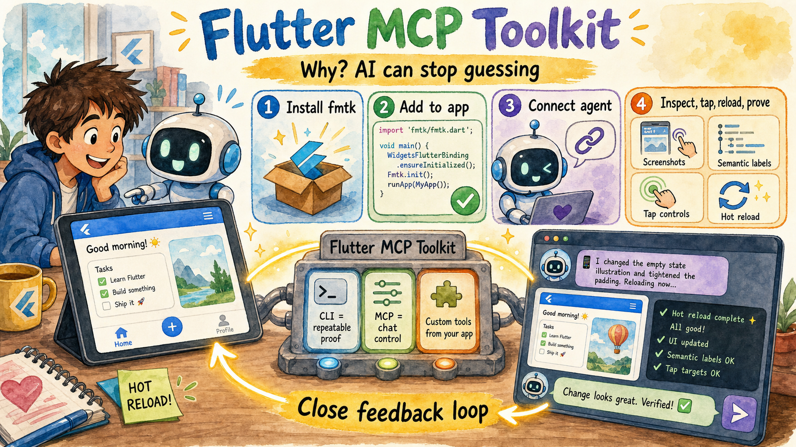

# Flutter MCP Toolkit

Connect a **debug** Flutter app to your AI assistant: semantic UI, errors, input, hot reload, and tools your app defines at runtime.

**Agents:** read [llms.txt](./llms.txt) or repo-root [llms.txt](https://github.com/Arenukvern/mcp_flutter/blob/main/llms.txt).

## Evaluate quickly

| | |
| --- | --- |
| **What** | `flutter-mcp-toolkit-server` + `mcp_toolkit` in your app |
| **Agent superpowers** | Discover app → snapshot UI → tap/type → reload → custom tools |
| **vs Dart MCP** | Dart MCP = project tooling. This = **live** app UI and app-registered tools. |
| **Install** | [Marketplace / plugin](./install/clients.mdx) or [install script](./install/platforms.mdx) |
| **Proof** | [Quickstart](./quickstart.mdx) → `doctor` → `fmt_semantic_snapshot` |
| **Tools** | [Generated reference](./reference/tools.mdx) |

## Get started

1. [Quickstart](./quickstart.mdx) — five minutes to first snapshot  
2. [Instrument your app](./install/app-setup.mdx)  
3. [Connect your agent](./install/clients.mdx)

## Use cases

| Goal | Page |
| --- | --- |
| Debug loop | [Debug a running app](./use-cases/debug-a-running-app.mdx) |
| See UI | [See the UI](./use-cases/see-the-ui.mdx) |
| Drive UI | [Drive the UI](./use-cases/drive-the-ui.mdx) |
| Hot reload | [Hot reload loop](./use-cases/hot-reload-loop.mdx) |
| Custom tools | [Custom tools](./use-cases/custom-tools.mdx) |
| CI / scripts | [CI and scripts](./use-cases/ci-and-scripts.mdx) |
| E2E | [E2E scenarios](./use-cases/e2e-scenarios.mdx) |
| Many apps | [Multiple apps](./use-cases/multiple-apps.mdx) |

## Concepts

- [How it works](./concepts/how-it-works.mdx) — includes history (born as Flutter Inspector MCP)  
- [Video walkthroughs](./concepts/video-walkthroughs.mdx)  
- [CLI vs MCP](./concepts/cli-vs-mcp.mdx)  
- [Automation chain](./concepts/automation-chain.mdx)  
- [Glossary](./concepts/glossary.mdx)

## Help

- [Troubleshooting](./troubleshooting.mdx)  
- [Migrations](./migration/migration_v2_to_v3.mdx)  
- [Decisions (ADRs)](./decisions/index.mdx)  
- [Contributing](./contributing/guide.mdx)