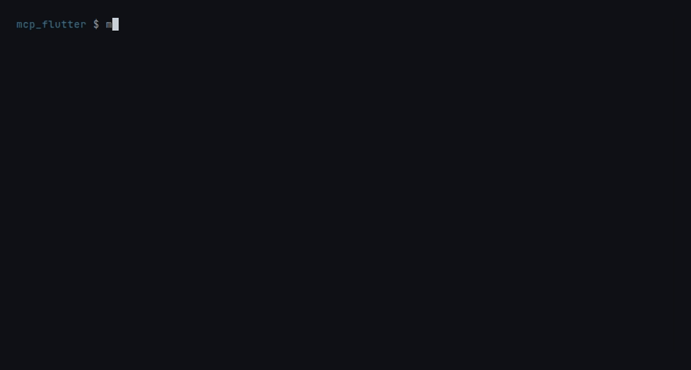

# See the UI

## Semantic snapshot (preferred)

Ask the agent for **`fmt_semantic_snapshot`**. You get refs, labels, roles, and bounds — enough to plan taps and form fills.

Example prompt:

> Take a semantic snapshot and list interactive controls on the home screen.

## Screenshots (pixels)

Use **`fmt_get_screenshots`** when you need rendered pixels. Captures go through the **Flutter render pipeline** and work with the window in the **background**.

Full-length recording (~6 MB): [view_screenshots.gif](../view_screenshots.gif)

Enable server `--images` and ensure `ext.mcp.toolkit.view_screenshots` is present ([troubleshooting](../troubleshooting.mdx)).

## View metadata

**`fmt_get_view_details`** / resources under `visual://localhost/...` supplement snapshots with layout-oriented data when enabled.

## Skills

- `flutter-mcp-toolkit-inspect`
- `flutter-mcp`

## See also

- [How it works — seeing the app](../concepts/how-it-works.mdx)
- [Drive the UI](./drive-the-ui.mdx)
- [Tool reference](../reference/tools.mdx)